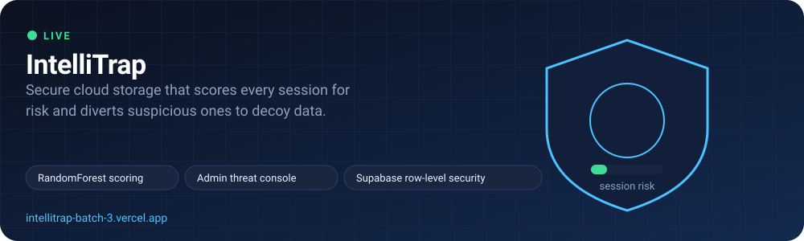
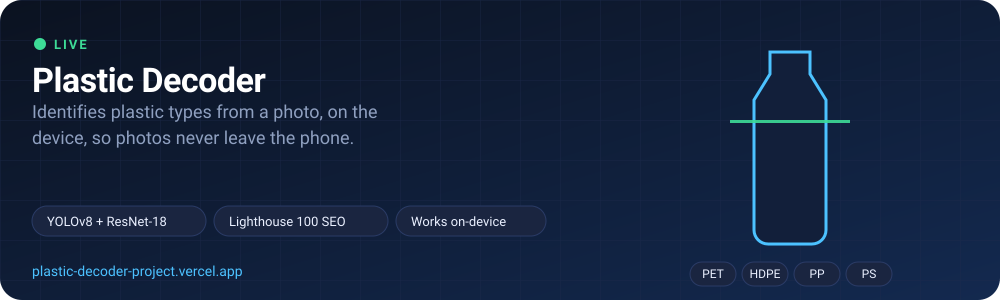

   
  
  
  

## About me

**Final-year B.Tech student, Computer Science and Engineering, CMR Technical Campus, Hyderabad.**
Looking for a **data and analytics internship**.

I turn problems into working, deployed data projects: I define the requirements, review and test the results, and ship with live demos and documentation. I want an internship where I can work on real business data and learn from an analytics team.

## At a glance

<picture>
<source media="(prefers-color-scheme: dark)" srcset="https://raw.githubusercontent.com/Vedhrishi/Vedhrishi/output/github-snake-dark.svg">

</picture>

## Live projects

Five projects running in production. Click a card to open it.

 <a href="https://vedhrishi.github.io/gemini-maps/">Open the app</a> · <a href="https://github.com/Vedhrishi/gemini-maps">Code</a>

 <a href="https://rishi-indian-stocks-explained.vercel.app">Open the site</a> · <a href="https://github.com/Vedhrishi/RISHI-INDIAN-STOCKS-EXPLAINED">Code</a>

 <a href="https://intellitrap-batch-3.vercel.app">Open the site</a> · <a href="https://github.com/Vedhrishi/INTELLITRAP">Code</a>

 <a href="https://plastic-decoder-project.vercel.app">Open the site</a> · <a href="https://github.com/Vedhrishi/AI-PLASTIC-SORTING-WEBSITE">Code</a>

 <a href="https://vedhrishi.github.io/bschool-atlas/">Open the site</a> · <a href="https://github.com/Vedhrishi/bschool-atlas">Code</a>

## More projects

<table width="100%">
<tr>
<td width="50%" valign="top"> 🔗 <a href="https://github.com/Vedhrishi/BIO-LOCK">Code</a></td>
<td width="50%"></td>
</tr>
</table>

### Project details

<b>Gemini Maps</b>: navigation that warns you about the road

- **Problem:** maps tell you the fastest route but not about the pothole, flood or accident on it.
- **What it does:** drivers report hazards by photo or voice and nearby users see them within seconds. A Guardian agent compares safer alternatives and re-routes only when one is clearly better. Spoken traffic summary for every trip, "nearest petrol pump" style search, and hands-free voice control.
- **Data:** about 4.9 million India places and named buildings from Overture Maps, cached on the device; live traffic from TomTom; routing from OSRM. Hazards come only from real user reports.
- **Tech:** React, TypeScript, Vite, MapLibre, FastAPI, Render, GitHub Pages. 12 backend tests.
- Built for the Meta Global AI Developer Hackathon, 2026.
- [Live app](https://vedhrishi.github.io/gemini-maps/) · [Code](https://github.com/Vedhrishi/gemini-maps)

<b>RISHI | Indian Stocks Explained</b>: financial literacy for first-time Indian investors

- **Problem:** stock-market education for beginners is jargon-heavy and mostly English-only.
- **What it is:** a series of 80-second animated episodes (100 episodes, 200 short videos, released twice a day) on Instagram, YouTube and Facebook, plus a website that gathers them.
- **Data and tech:** episode metadata and schedules in Supabase (Postgres); static front end on Vercel; strict content-security policy and database row-level security.
- **Rules I set:** education only, no stock tips, no return promises, clear disclaimers.
- [Live site](https://rishi-indian-stocks-explained.vercel.app) · [Code](https://github.com/Vedhrishi/RISHI-INDIAN-STOCKS-EXPLAINED)

<b>IntelliTrap</b>: secure cloud storage with risk scoring

- **Problem:** stolen credentials let attackers browse a user's files unnoticed.
- **What it does:** a RandomForest model scores each session; suspicious sessions are diverted to decoy data while an admin console shows the threat. The model is trained on a synthetic dataset, and the app works at the application layer only.
- **Tech:** TypeScript, Vite, Supabase (Postgres, row-level security), scikit-learn.
- [Live demo](https://intellitrap-batch-3.vercel.app) · [Code](https://github.com/Vedhrishi/INTELLITRAP)

<b>Plastic Decoder</b>: plastic resin identification in the browser

- **Problem:** people cannot tell plastic types apart, so recyclable material gets contaminated.
- **What it does:** identifies PET, HDPE, PP and PS from a photo and gives disposal guidance. YOLOv8 and ResNet-18 run on-device, so photos never leave the phone.
- **Measured:** mobile Lighthouse 100 SEO and 100 best practices (checked 25 Oct 2026).
- **Tech:** React, Vite, ONNX models, JavaScript.
- [Live demo](https://plastic-decoder-project.vercel.app) · [Code](https://github.com/Vedhrishi/AI-PLASTIC-SORTING-WEBSITE)

<b>BioLock SSD</b>: face-authenticated drive lock

- **Problem:** a lost USB drive means lost data.
- **What it does:** unlocks only after presence, blink and head-turn checks plus a face match, and refuses to run from an internal drive. The vault key is derived with PBKDF2 and Fernet. Includes 25 automated tests in CI.
- **Tech:** Python, OpenCV, Tkinter, Windows desktop.
- [Code](https://github.com/Vedhrishi/BIO-LOCK)

<b>B-School Atlas</b>: compare MBA destinations and Indian B-school cut-offs

- **Problem:** MBA applicants juggle scattered data on fees, cut-offs and salaries across countries and exams.
- **What it does:** compares destinations by cost, salary and payback; filters Indian colleges by exam and percentile; sidebar navigation with site-wide search over colleges, countries, exams and glossary terms.
- **Tech:** vanilla JavaScript, HTML and CSS, unit tests with `node --test`, GitHub Actions deploy to GitHub Pages.
- [Live site](https://vedhrishi.github.io/bschool-atlas/) · [Code](https://github.com/Vedhrishi/bschool-atlas)

## Tools used

## Certifications

| Credential | Issuer | Completed | Verify |
|---|---|---|---|
| **Google AI Specialization** (7 courses, incl. AI for Data Analysis) | Google via Coursera | Jun 2026 | [Verify](https://coursera.org/verify/professional-cert/KE2UAD30CICU) |
| Financial Markets | Yale University via Coursera | May 2026 | [Verify](https://coursera.org/verify/BKT2CQFSGG1D) |
| Foundations of Project Management | Google via Coursera | Jul 2026 | [Verify](https://coursera.org/verify/FU65M9YKDMUZ) |
| Generative AI: Prompt Engineering Basics | IBM via Coursera | Jun 2026 | [Course](https://www.coursera.org/learn/generative-ai-prompt-engineering-for-everyone) |
| Drupal Training | EduPyramids, SINE, IIT Bombay | Mar 2026 | Certificate ID 3920325YWC |

## Contact

Open to data and analytics internships. Email [vedhrishi54@gmail.com](mailto:vedhrishi54@gmail.com) or message me on [LinkedIn](https://www.linkedin.com/in/vedhrishi-pasupuleti/).

Stats and cards above refresh automatically every day from my GitHub data.
